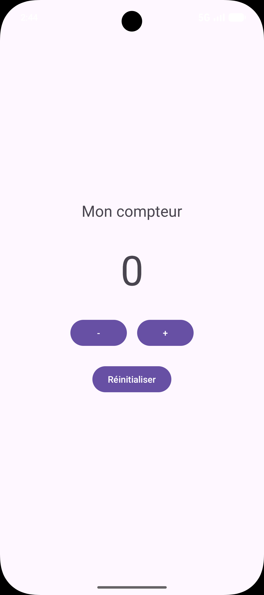

# CompteurAndroid

Application Android (Kotlin) de type compteur : un TextView affiche une valeur que l'on peut augmenter, diminuer ou remettre à zéro avec des boutons.

TP1 Android Studio, Licence DSI, ISET.

## Fonctionnalités

- Affichage de la valeur du compteur dans un TextView
- Bouton **+** : augmente le compteur de 1
- Bouton **-** : diminue le compteur de 1
- Bouton **Réinitialiser** : remet le compteur à 0

## Capture d'écran

## Travail à rendre

- [`compte_rendu_TP_Android_Compteur.pdf`](compte_rendu_TP_Android_Compteur.pdf) : compte rendu du TP
- [`Extrait du code.pdf`](Extrait%20du%20code.pdf) : extrait du code de l'application
- [`Capture`](Capture) : capture d'écran de l'application

## Fichiers principaux

- `app/src/main/res/layout/activity_main.xml` : interface (TextView et boutons)
- `app/src/main/java/com/example/compteurandroid/MainActivity.kt` : logique du compteur
- `app/src/main/res/values/strings.xml` : textes de l'application

## Technologies

- Langage : Kotlin
- Modèle de projet : Empty Views Activity
- SDK minimum : API 24

## Lancer le projet

1. Cloner le dépôt puis l'ouvrir avec Android Studio.
2. Attendre la fin de la synchronisation Gradle.
3. Lancer l'application sur un émulateur ou un téléphone.
